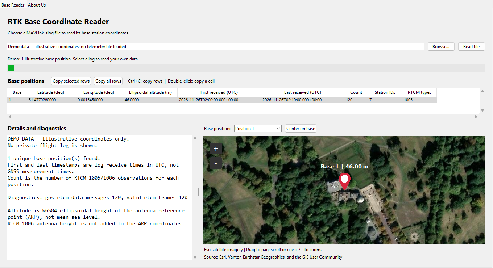

# RTK Base Coordinate Reader

**Developer: GouravD · Status: Alpha (v0.1.0-alpha.1)**

A Windows desktop app and Python CLI that extract RTK base station coordinates from ArduPilot MAVLink telemetry logs and display timestamped results alongside an Esri satellite map.



*App screenshot with clearly labeled illustrative demo coordinates. No private flight log data is shown. Imagery attribution appears in the map panel.*

## Features

- Reads `.tlog` files containing `GPS_RTCM_DATA` (message 233).
- Reassembles MAVLink RTCM fragments and validates RTCM3 frames.
- Decodes RTCM 1005/1006 antenna reference positions and converts ECEF coordinates to WGS84 latitude, longitude, and ellipsoidal altitude.
- Lists every unique base position with first/last UTC receive timestamps, observation counts, station IDs, and RTCM message types.
- Copies rows as tab-separated text for spreadsheets; double-click a cell to copy its value.
- Shows base locations on an Esri satellite map, with pan, zoom, and position selection.
- Keeps parsing diagnostics and coordinate notes below the results table.

## Why use this? / FAQ

### How to extract RTK base station coordinates from an ArduPilot .tlog file

Open the app, select your `.tlog` file, and click **Read file**. The app reads the recorded
RTCM correction stream to recover the base antenna's latitude, longitude, and ellipsoidal
altitude. It lists every unique position with first/last UTC receive timestamps and counts,
so you can inspect position changes and copy the results into a spreadsheet.

### Decode RTCM 1005 / 1006 from GPS_RTCM_DATA

The extractor filters MAVLink `GPS_RTCM_DATA` messages (ID 233), reassembles their fragments
using the sequence and fragment IDs, validates RTCM3 frames, and decodes messages 1005/1006
with `pyrtcm`. It converts their ECEF antenna reference coordinates to WGS84 latitude,
longitude, and ellipsoidal altitude. The same parser powers the UI and the CLI.

### Why does my .tlog show no GPS_RTCM_DATA or no base position?

The log may not contain the RTCM injection stream, or that stream may lack valid 1005/1006
messages. Missing fragments and damaged or incomplete frames can also prevent decoding;
check the diagnostics below the table. A rover GPS position alone does not establish the
base station's antenna coordinates.

## Use the portable Windows app

Download **RTK-Base-Reader.exe** from the repository's **Releases** page and double-click it. Python is included in the executable.

Click **Browse**, choose a `.tlog` file, and click **Read file**. The file field starts empty. Internet is required for map imagery; coordinate extraction works offline.

## Install and run from source

On Windows, install Python **3.10 or newer** with Tcl/Tk support and the Python launcher or Python on PATH. The alpha executable was built and tested using Python 3.14 on Windows x64.

1. Download the repository ZIP and extract it, or clone the repository.
2. Double-click **Install Dependencies.bat**. It creates `.venv` and installs the runtime and build dependencies together.
3. Double-click **Open RTK Reader.bat**.

The launcher uses `dist/RTK Base Reader.exe` if present; otherwise it runs the Python UI from `.venv`.

Equivalent commands:

```powershell
python install_dependencies.py
.\.venv\Scripts\python.exe base_ui.py
```

Check an existing installation without downloading packages:

```powershell
python install_dependencies.py --check
```

## Command-line extraction

```powershell
.\.venv\Scripts\python.exe extract_base.py "C:\path\flight.tlog"
```

The CLI exits with `0` when it finds positions, `2` when no positions are found, and `1` for file-reading errors.

## Build and verify

```powershell
.\.venv\Scripts\python.exe build_app.py
.\.venv\Scripts\python.exe -m unittest -v
```

The standalone executable is written to `dist/RTK Base Reader.exe`.

```powershell
& ".\dist\RTK Base Reader.exe" --self-test "C:\path\flight.tlog" "C:\path\report.json"
```

The packaged self-test checks startup with an empty file field, the About Us tab, log extraction, table rows, timestamps, clipboard output, and map markers. Live imagery depends on internet access.

## Coordinate and log notes

- Altitude is WGS84 ellipsoidal height at the antenna reference point (ARP), not mean sea level. RTCM 1006 antenna height is not added again.
- Timestamps are the log's receive timestamps in UTC, not GNSS measurement epochs.
- The log must include RTCM injection messages and valid 1005/1006 frames to recover base positions.
- Fragment reordering is bounded to half of the modulo-32 sequence space. Missing or corrupt data is reported in diagnostics.
- Satellite imagery is a visual reference and may have alignment offsets relative to surveyed coordinates.

Source control excludes virtual environments, build caches, generated Tcl/Tk files, and telemetry logs. The compiled app is distributed as a release asset.

## License

The project's original code is licensed under the [GNU General Public License version 3](LICENSE)
(SPDX: `GPL-3.0-only`). Copyright (c) 2026 Gourav1997.

You may copy, modify, and redistribute the code under GPLv3. When distributing a
covered modified version, you must provide corresponding source code under GPLv3
and preserve the required notices. The software comes without warranty.
Third-party dependencies retain their own licenses.

GPLv3 does not require notifying the original developer about private modifications.
